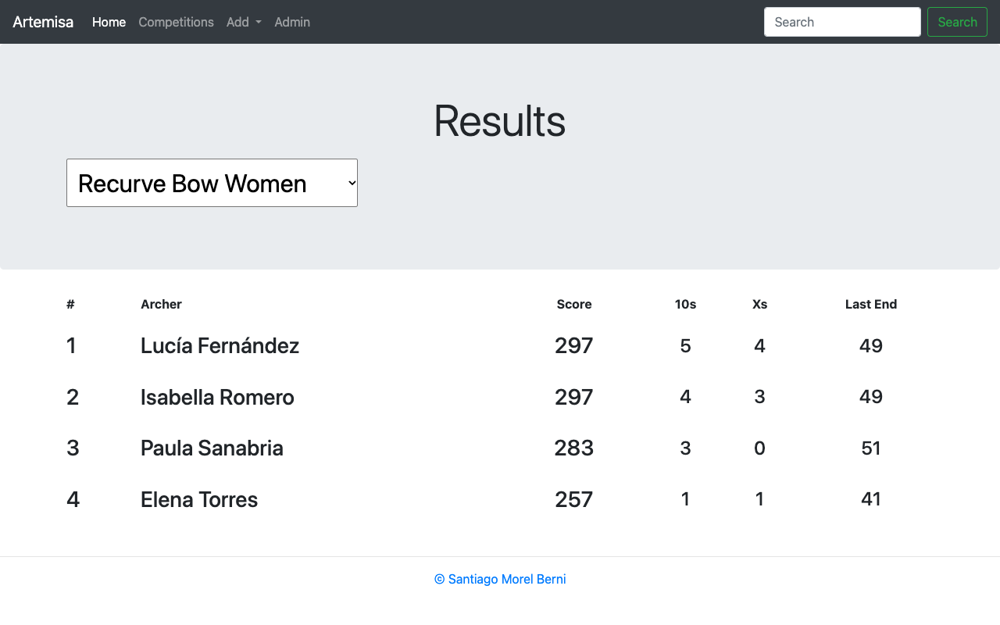
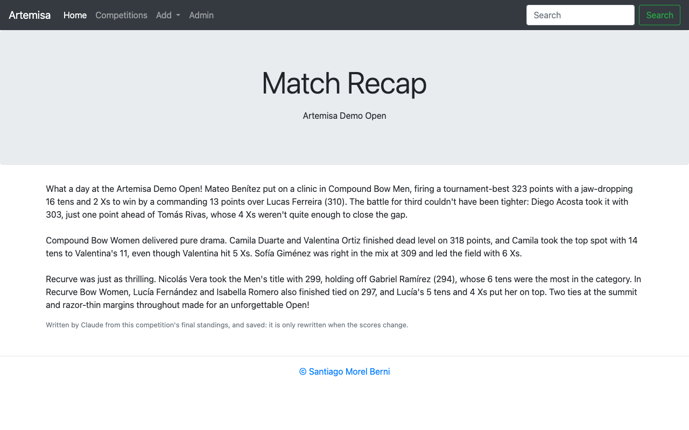
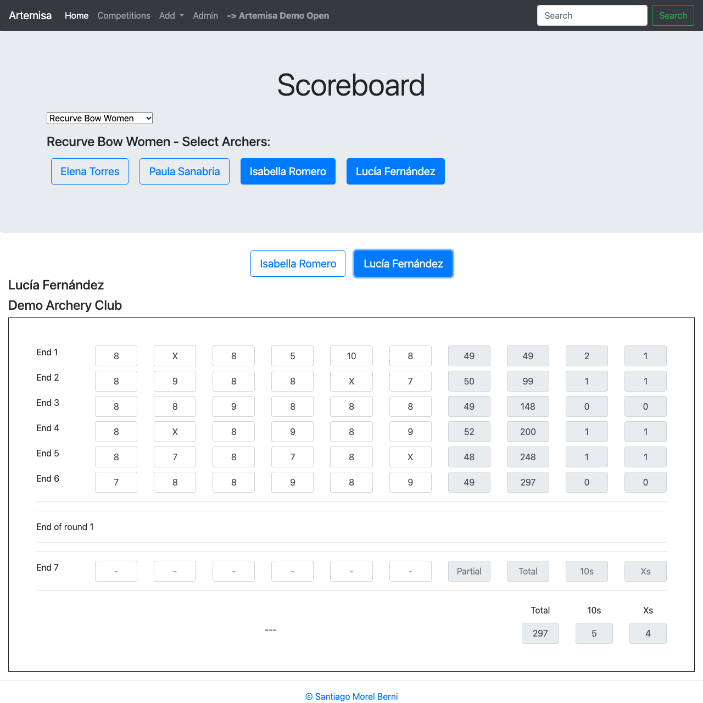
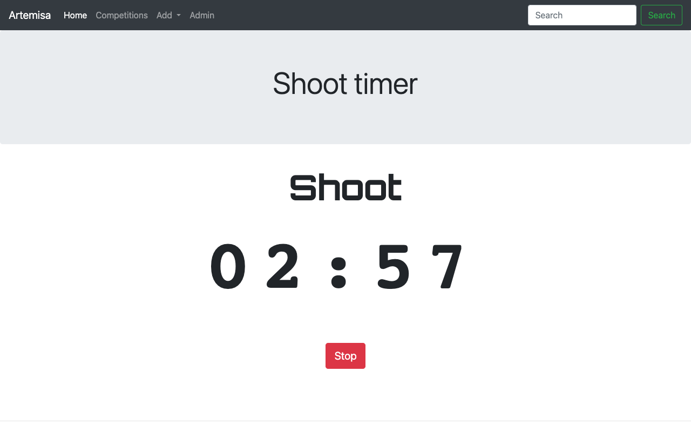
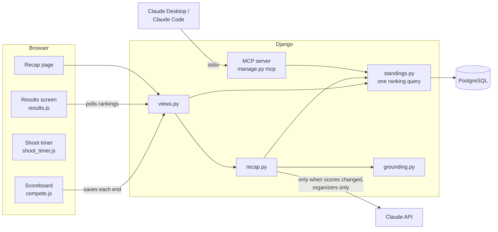

# Artemisa

[](https://github.com/athospy/artemisa/actions/workflows/test.yml)

**A scoring platform for archery tournaments**: a touch-screen scoreboard for judges, a
live leaderboard for the big screen, a shoot timer for the range, and a match recap written
by Claude. Django + PostgreSQL, used to run real archery events.

**[Try the live demo →](https://artemisa.lajota.com.py/demo/)** (a made-up tournament, no login needed)

| Live results (big screen) | AI match recap |
|---|---|
|  |  |
| **Scoreboard (judges)** | **Shoot timer** |
|  |  |

## What it does

- **Scoreboard.** Judges pick archers and type each arrow on a large on-screen keypad
  (0-10, `X`, `M`), end by end (6 arrows, up to 12 ends). Each end is saved when the judge
  moves on to the next one, and restored if the page reloads.
- **Live results.** A leaderboard per category that cycles through the categories every
  few seconds, made for a projector. Ties are broken the way archery rules do: total, then
  10s (X counts as a 10), then Xs, then the last end.
- **Shoot timer.** 10 seconds to get ready, 3 minutes to shoot, with sound cues and a
  10-second warning.
- **AI match recap.** Claude writes a short spectator recap from the final standings. It's
  saved and reused until the scores change, and an automated check confirms it only uses
  facts from the standings ([details](#how-the-ai-match-recap-stays-grounded)).
- **MCP server.** Ask Claude Desktop or Claude Code about your tournaments: "who is leading
  Recurve Bow Women?" ([details](#use-it-from-claude-mcp-server)).
- **Public demo.** One competition can be marked as a demo: its results, timer and recap
  are visible without logging in. Real events stay private.

## How it's built



- **Data model:** `Competition`, `Category` and `Archer` meet in `Registration`; each arrow
  is one `Score` row (end 1-12, arrow 1-6, value `0-10`/`X`/`M`).
- **One ranking query.** Totals, 10s, Xs and last-end points are computed in a single
  PostgreSQL aggregation (`standings.py`). The results screen, the AI recap and the MCP
  server all use it, so they can't disagree.
- **No build step on the frontend.** Server-rendered templates (Bootstrap) with one small
  vanilla JavaScript file per screen, so it runs on whatever laptop is at the range.
- **Deploys only on green.** GitHub Actions runs the tests on every pull request and push,
  and the production deploy starts only after they pass ([docs/deployment.md](docs/deployment.md)).

## Run it locally

Needs Python 3.10+ and Docker. Check `python3 --version` first: the `python3` that ships
with macOS can be older, in which case create the venv with a newer one (for example
`python3.12 -m venv venv`).

```bash
git clone https://github.com/athospy/artemisa.git
cd artemisa
docker compose up -d db                 # PostgreSQL on port 54322
python3 -m venv venv && source venv/bin/activate
pip install -r requirements.txt
cp .env.example .env
python manage.py migrate
python manage.py seed_demo              # the demo tournament, with its saved AI recap
python manage.py createsuperuser        # an organizer account for scoring
python manage.py runserver
```

Open <http://127.0.0.1:8000/demo/>. Log in at `/accounts/login/` to score.

Tests (the AI calls are mocked, no API key needed):

```bash
python manage.py test artemisa
```

## How the AI match recap stays grounded

The recap is written by Claude (`claude-opus-5-5`) from the competition's final standings,
and the prompt says to use only those facts. `artemisa/grounding.py` checks that
deterministically: every number in a recap must be a score, a 10s/Xs count, a category size
or a gap between two archers in the same category, and every two-word name must belong to
an archer, category or the competition. A failing recap is logged at live events and
refused for the public demo (`seed_demo --refresh-recap`).

Each recap is saved together with the exact standings text it was written from. While the
scores don't change, the saved text is reused, so visitors never trigger an API call and
the live server doesn't even need an API key for the demo.

To measure it on real generations (each run is a paid API call):

```bash
python manage.py eval_recap --runs 10 --out evals/recap_grounding.json
```

**Latest result (2026-11-19, `claude-opus-5-5`, demo tournament): 10/10 recaps grounded.**
The first scoring was 9/10. The one failure was a bug in the checker, not the model: a
possessive name ("Tomás Rivas' 302") wasn't recognised. After fixing it, the saved recaps
were scored again without new API calls (`eval_recap --rescore`). Superlative claims the
checker can't verify ("most Xs in the competition") were checked by hand in all 10 and
were correct. Every recap is in [`evals/recap_grounding.json`](evals/recap_grounding.json).

## Use it from Claude (MCP server)

Artemisa ships a small, read-only [MCP](https://modelcontextprotocol.io) server, so Claude
Desktop or Claude Code can answer questions about your tournaments ("who is leading
Recurve Bow Women?", "show me Lucía's scorecard"). It runs locally over stdio and reads the
database your `.env` points at. No tool writes data, returns archer emails, or calls the
Anthropic API.

| Tool | What it returns |
|---|---|
| `list_competitions` | Competitions with ids, dates, categories and archer counts |
| `get_leaderboard` | Ranked archers (score, 10s, Xs, last end) for one category or all |
| `get_archer_scorecard` | One archer's arrows end by end, running total and rank |
| `get_match_recap` | The saved AI recap, if it matches the current standings |

**Claude Code** (from the repo folder):

```bash
claude mcp add artemisa -- "$PWD/venv/bin/python" "$PWD/manage.py" mcp
```

**Claude Desktop** (`claude_desktop_config.json`, use absolute paths):

```json
{
  "mcpServers": {
    "artemisa": {
      "command": "/path/to/artemisa/venv/bin/python",
      "args": ["/path/to/artemisa/manage.py", "mcp"]
    }
  }
}
```

## Project layout

```
artemisa/                  the Django app
  models.py                Competition, Category, Archer, Registration, Score
  views.py                 pages and the JSON endpoints the screens call
  standings.py             the ranking query (scoring rules + tiebreakers)
  recap.py, grounding.py   AI match recap and its grounding check
  mcp_tools.py             the MCP server's tools
  management/commands/     seed_demo, eval_recap, mcp
  static/artemisa/         one JS file per screen (scoreboard, results, timer, recap)
  tests.py                 test suite (run in CI)
capstone/                  Django project settings
evals/                     saved eval results
docs/                      deployment guide and screenshots
```

## Background

Artemisa started as a course capstone project and grew into the system used to score real
archery tournaments, built and maintained by
[Santiago Morel Berni](https://github.com/athospy) as the sole developer.
